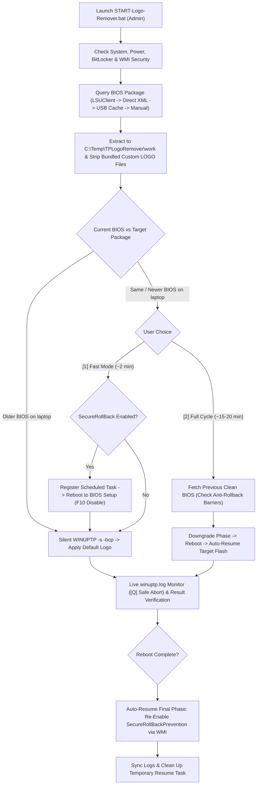

# ThinkPad Custom Logo Remover

A portable Windows PowerShell (`5.1+`) toolkit for **ThinkPad** corporate fleet refurbishment — designed to strip custom OEM/enterprise BIOS boot logos, restore the stock Lenovo startup logo safely, and leave firmware security settings intact.

[](LICENSE)
[](scripts/Remove-ThinkPadLogo.ps1)
[](TESTED-DEVICES.md)

---

## Why This Tool Exists

Refurbished corporate Lenovo ThinkPads frequently carry an embedded custom company boot splash image (`LOGO.*`) inside the SPI BIOS/UEFI region. Simply flashing the same BIOS version interactively or running a generic updater often fails silently, preserves the existing custom image, or gets blocked by **`SecureRollBackPrevention`** (Error 182).

**ThinkPad Custom Logo Remover** automates the safe, repeatable bench workflow end-to-end from a single USB drive:

- Detects system model (`MTM4`), current BIOS version, power state, BitLocker status, and Lenovo WMI BIOS security settings.
- Fetches official Lenovo BIOS packages via bundled **`LSUClient` v1.8.2** (with direct Lenovo catalog XML fallback and offline USB cache).
- Strips any loose custom `LOGO.*` files bundled inside extracted work directories so the updater restores Lenovo's factory image (`-s -bcp`).
- Handles laptops **already running the latest BIOS**:
  - **Fast Mode (~2 min)**: Prompts once to disable `SecureRollBackPrevention` in BIOS Setup (`F10`), auto-resumes after reboot via a temporary Scheduled Task, flashes silently with `WINUPTP -s -bcp`, reboots, and **automatically re-enables `SecureRollBackPrevention` via Lenovo WMI**.
  - **Full Cycle Mode (~15–20 min)**: Downloads the previous clean official BIOS version (checking README rollback barriers), performs a controlled downgrade, automatically restores the latest BIOS version after reboot, and re-enables `SecureRollBackPrevention` at the end.
- Suspends BitLocker protection cleanly (`RebootCount 1`) only for the flash operation when needed.
- Streams real-time `winuptp.log` progress with elapsed time and supports clean `[Q]` manual abort if a legacy updater stalls.
- Logs every bench action to local `C:\Temp\TPLogoRemover\logs` and mirrors logs back to the USB `logs/` directory (`history.csv` + per-run `winuptp_*.log`).

---

## Verified Compatibility

Field-tested across **8 ThinkPad `MTM4` codes / 7 model families (15 units total)** and **5 Lenovo `WINUPTP` engine generations (`v35.08` – `v44.14`)** with **7/7 automated WMI rollback re-enable passes**.

| `MTM4` | Model Family | Verified Package(s) | `WINUPTP` Version | Result |
|---|---|---|---|---|
| `21MM` | ThinkPad T14 Gen 5 | `n47uj14w` (`1.19`), `n47uj12w` (`1.17`) | `v42.6` | Verified (upgrade, `-s -bcp`, full cycle + WMI restore) |
| `21MQ` | ThinkPad T14 Gen 5 (variant) | `n47uj14w` (`1.19`) | `v42.6` *(shared)* | Indexed & cache-validated (`N47ET30*`) |
| `21K4` | ThinkPad T14 Gen 4 | `r2fuj72w` (`1.52`) | `v44.14` | Verified (`-s -bcp` + WMI restore) |
| `21K8` | ThinkPad T16 Gen 2 | `r2fuj72w` (`1.52`) | `v44.14` | Verified (`-s -bcp` + WMI restore) |
| `21BV` | ThinkPad T16 Gen 1 | `n3buj25w` (`1.49/1.29`) | `v37.24` | Verified (dual-prefix package, BIOS + EC, `-s -bcp` + WMI restore) |
| `21A7` | ThinkPad T15p Gen 2i | `n38uj25w` (`1.84`) | `v36.33` | Verified (standard BIOS + EC upgrade `-s -bcp`) |
| `20XL` | ThinkPad T14 Gen 2a | `r1muj65w` (`1.35`) | `v35.08` | Verified (`-s -bcp` + WMI restore) |
| `20UE` | ThinkPad T14s Gen 1 | `r1buj87w` (`1.56`) | — | Verified (`Win11` -> direct XML fallback & cache) |

See [TESTED-DEVICES.md](TESTED-DEVICES.md) for anonymized unit telemetry, sanitized log excerpts, and real-world updater findings.

---

## Requirements & Safety Checks

- **OS**: Windows 10 or Windows 11 (uses built-in Windows PowerShell `5.1`, no external runtime install needed).
- **Privileges**: Administrator rights (automatically requested via UAC in `START-Logo-Remover.bat`).
- **Power**: AC adapter connected **and** battery >= 25% recommended before flashing (can be overridden cleanly from the prompt if on bench DC power or with `-SkipPowerCheck`).
- **BIOS Supervisor Password**: Should be absent, or you must know it when saving `F10` changes in BIOS Setup.
- **`Flash BIOS Updating by End-Users`**: Must be enabled in BIOS Security -> UEFI BIOS Update Option (the script checks and warns via WMI).
- **USB Path**: Keep the root folder path without spaces if caching directly on USB (`LSUClient` does not allow spaces in `-Path`; if spaces are detected, the script automatically falls back to `C:\Temp\TPLogoRemover\cache`).

---

## Repository Structure

```text
thinkpad-logo-remover/
├── START-Logo-Remover.bat          # Double-click launcher (auto-elevates to Admin)
├── PRELOAD-Models.bat              # Pre-download official BIOS packages to USB cache
├── scripts/
│   ├── Remove-ThinkPadLogo.ps1     # Main guided flash, downgrade cycle & WMI auto-resume engine
│   └── Preload-ThinkPadBios.ps1    # Bulk offline USB cache downloader
├── modules/
│   └── LSUClient/                  # Bundled jantari/LSUClient v1.8.2 (MIT)
├── cache/                          # Downloaded Lenovo BIOS packages & model-index.json (gitignored)
├── logs/                           # Bench execution history.csv & winuptp_*.log archive (gitignored)
├── TESTED-DEVICES.md               # Anonymized field-test compatibility report
├── THIRD-PARTY-NOTICES.md          # Bundled dependency licenses
└── LICENSE                         # MIT License
```

---

## Quick Start (Bench Workflow)

1. Copy this repository onto a USB flash drive (e.g. `E:\ThinkPad-Logo-Remover\`).
2. Boot the target ThinkPad into Windows and plug in AC power.
3. Double-click **`START-Logo-Remover.bat`** (confirm the UAC prompt).
4. Review the detected `MTM4`, current BIOS version, battery/AC status, BitLocker state, and `SecureRollBackPrevention` state.
5. Choose the recommended flow:
   - **Newer BIOS available**: Select **`[1] Silent WINUPTP -s -bcp`** -> reboot when prompted.
   - **Same/newer BIOS already installed**:
     - Select **`[1] FAST MODE (~2 min)`** first (sufficient on most modern ThinkPads). If `SecureRollBackPrevention` is `Enable`, confirm reboot to BIOS Setup (`shutdown /r /fw /t 0`), set `SecureRollBackPrevention = Disabled` (or `Off`), press `F10` to save & exit, and let Windows auto-resume the silent flash and final WMI rollback re-enable.
     - If Fast Mode keeps the custom logo on a specific model, run again and select **`[2] FULL CYCLE`** to automate downgrade -> target restore -> WMI rollback re-enable.

> **Important**: During the pre-boot UEFI firmware flash screen after rebooting, **do not power off or unplug AC power** until the ThinkPad finishes rebooting back into Windows.

---

## Preloading Models for Offline Bench Use

To prepare an air-gapped USB drive on a connected workstation:

1. Double-click **`PRELOAD-Models.bat`** and enter comma-separated 4-character model codes (e.g., `21MM, 21K4, 21K8, 21BV, 21A7, 20XL`).
2. Or run directly from PowerShell with CLI parameters:

```powershell
# Download latest BIOS for multiple MTM4 codes
.\scripts\Preload-ThinkPadBios.ps1 -Models 21MM,21K4,21K8,21BV,21A7,20XL

# Load models from a text file (one MTM4 per line) and download all BIOS versions returned by the catalog instead of only the latest release
.\scripts\Preload-ThinkPadBios.ps1 -ModelsFile .\models.txt -IncludeAllVersions
```

Packages are stored under `cache/<PackageID>/` and indexed in `cache/model-index.json`. For rare unsupported models, you can also place an official Lenovo BIOS `.exe` under `cache/manual/<MTM4>/`.

---

## CLI Parameters

### `scripts/Remove-ThinkPadLogo.ps1`

| Parameter | Type | Description |
|---|---|---|
| `-OfflineOnly` | `switch` | Skip online Lenovo catalog queries and use `cache/model-index.json` or `cache/manual/<MTM4>/` only. |
| `-ModelOverride` | `string` | Override the WMI-detected 4-character MTM prefix (e.g. `-ModelOverride 20S0`). |
| `-SkipPowerCheck` | `switch` | Bypass the interactive AC power / 25% battery gate (use only when on trusted bench DC power). |
| `-Resume` | `switch` | Internal flag used automatically by the temporary `ThinkPadLogoRemover_Resume` scheduled task across reboots. |

### `scripts/Preload-ThinkPadBios.ps1`

| Parameter | Type | Description |
|---|---|---|
| `-Models` | `string[]` | List of 4-character Lenovo `MTM4` prefixes to cache onto USB. |
| `-ModelsFile` | `string` | Path to a text file containing one `MTM4` prefix per line (`#` comments supported). |
| `-IncludeAllVersions` | `switch` | Download all BIOS versions returned by Lenovo's catalog instead of only the latest package. |

---

## Automated Workflow Diagram



---

## Troubleshooting

- **Error 182 / `Secure RollBack prevention is enabled`**: The laptop firmware refuses same-version or older BIOS flashes while `SecureRollBackPrevention` is active. Accept the script's prompt to reboot into BIOS Setup (`shutdown /r /fw /t 0`), switch `SecureRollBackPrevention` to `Disabled`/`Off`, press `F10` to save & exit, and the script resumes automatically. Note that enabling `SecureRollBackPrevention` works via Lenovo WMI afterward, while **disabling** it always requires physical confirmation in BIOS Setup on modern ThinkPads.
- **Silent flash appears stalled (`ExitCode -999`)**: Press **`Q`** during the live log monitor to abort cleanly instead of killing the console. Re-run and pick **Interactive WINUPTP** (then select **No** when prompted about custom startup image) or **Full Cycle**.
- **`WINUPTP` exits with code `1` without flashing**: Running `-bcp` without `-s` (or hitting Error 182 on `WINUPTP v44.14`) exits `1` without writing flash. The script automatically runs `-s -bcp` and inspects `winuptp.log` for `BIOS Flash completed` before marking a run successful.
- **USB logs missing after immediate reboot**: Local logs are always written first to `C:\Temp\TPLogoRemover\logs` and mirrored to `logs/` on USB (`Sync-LocalLogsToUsb`) on every start/resume.

---

## License & Credits

- Project License: **MIT** — see [LICENSE](LICENSE).
- Bundles **[jantari/LSUClient](https://www.github.com/jantari/LSUClient)** `v1.8.2` (MIT License) — see [THIRD-PARTY-NOTICES.md](THIRD-PARTY-NOTICES.md).
- Disclaimer: Firmware flashing carries inherent hardware risk. Always use genuine Lenovo power supplies and read all security prompts before flashing production machines.
